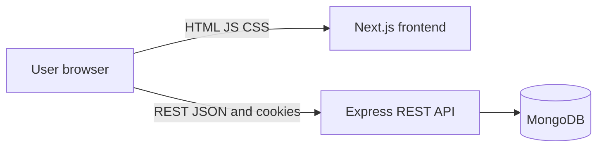
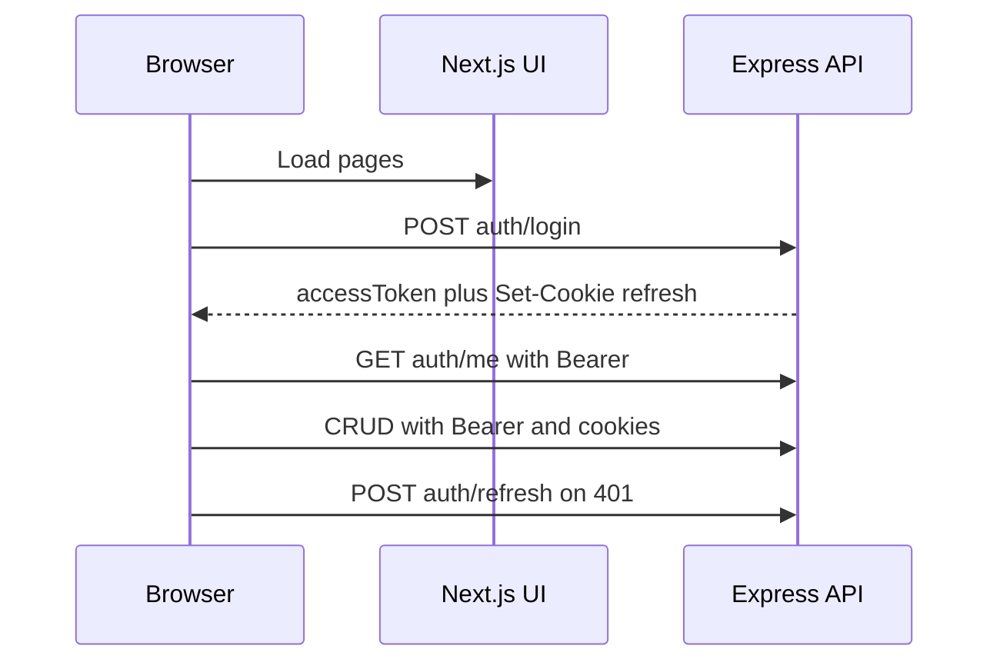
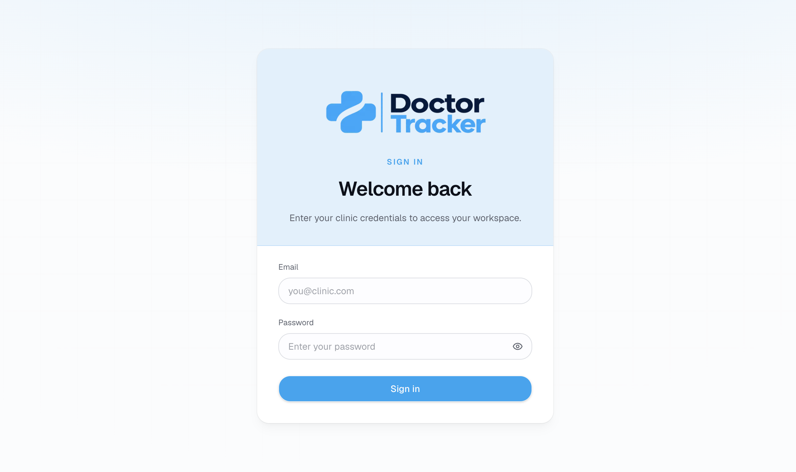
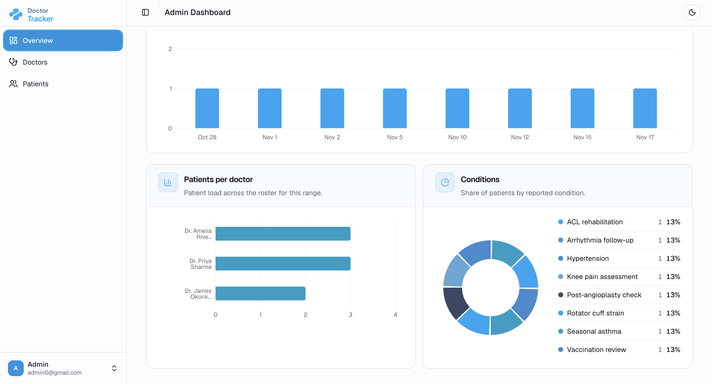
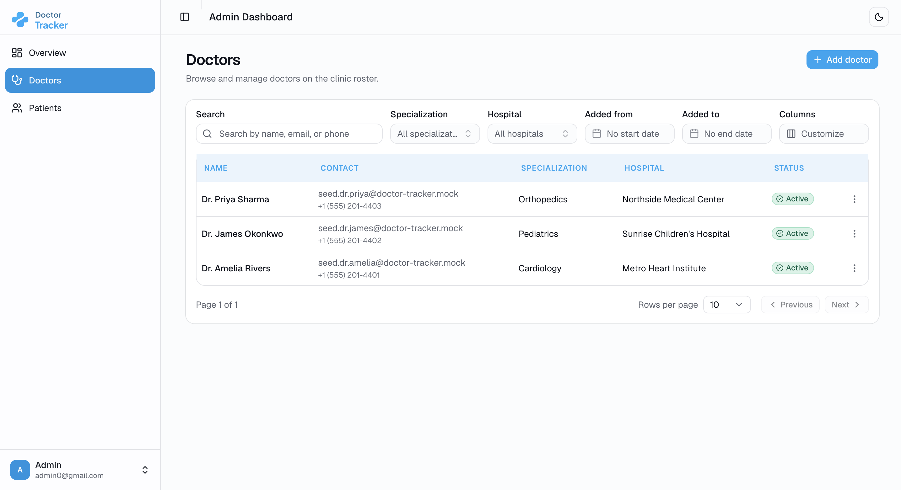
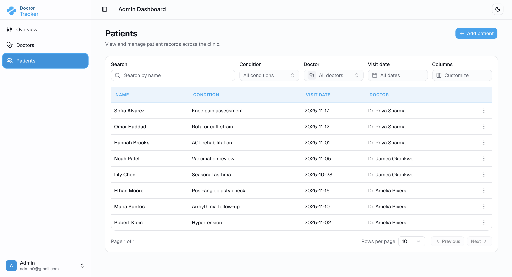
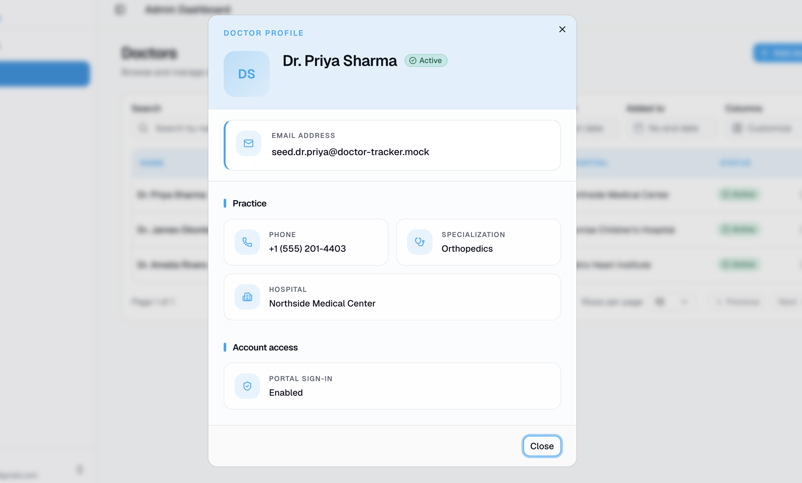
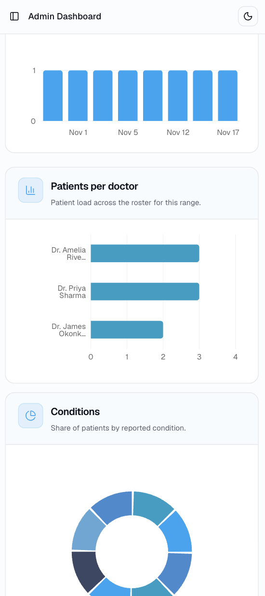
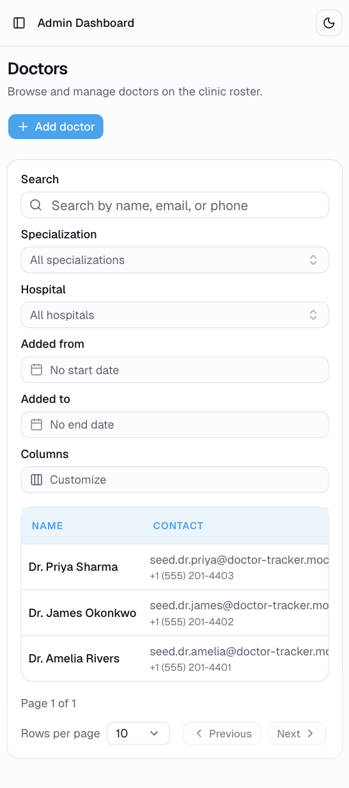

# Doctor Tracker — Frontend

## Project links

| Item | URL |
|------|-----|
| Live app | https://doctor-tracker-taupe.vercel.app/ |
| Frontend repository | https://github.com/erfan-sahil/doctor-tracker-client |
| Backend API base | https://doctor-tracker-backend-c1v8.onrender.com/api/v1 |
| Backend documentation | https://github.com/erfan-sahil/doctor-tracker-backend/blob/main/README.md |

---

## A. Description

**Doctor Tracker** is a secure administrative web application for managing clinic doctors and patients. This repository is the **Next.js client**: authenticated users sign in, explore an analytics dashboard, and work with patient records. Administrators additionally manage the full doctor roster. The UI is responsive, uses loading and empty states, confirmation dialogs for destructive actions, and client-side validation. All protected routes require a valid session; role-based guards limit who can open admin-only screens. The app talks to a **standalone Express API** (separate repo) using REST—API requests are issued from the **browser** via Axios, not through a Next.js API proxy.

---

## Beyond the assignment

The project brief required authenticated **admin** access to doctors and patients. The following extras were implemented voluntarily:

### Role-based access control (Doctor role)

- **Admin:** Dashboard, doctors directory, and all patients.
- **Doctor:** Dashboard and **only their assigned patients**—no doctor roster (`AdminGuard` on [`src/app/(dashboard)/doctors/layout.tsx`](src/app/(dashboard)/doctors/layout.tsx)).
- Navigation and guards align with backend enforcement so the API cannot be bypassed from the UI alone.

See the [backend README](https://github.com/erfan-sahil/doctor-tracker-backend/blob/main/README.md#beyond-the-assignment) for server-side RBAC details.

### Docker

Docker setup lives in the **backend** repository only. This frontend runs with `npm run dev` locally or deploys to Vercel; no container is required here.

---

## B. Setup guide

### Prerequisites

- Node.js 20+ (see [`package.json`](package.json))
- npm
- A running [Doctor Tracker API](https://github.com/erfan-sahil/doctor-tracker-backend/blob/main/README.md#b-setup-guide) (local or hosted)

### Installation

```bash
git clone https://github.com/erfan-sahil/doctor-tracker-client.git
cd doctor-tracker-client
npm ci
```

### Environment variables

Copy the example file and point the client at your API:

```bash
cp .env.example .env.local
```

| Variable | Description |
|----------|-------------|
| `NEXT_PUBLIC_API_URL` | Base URL for the REST API (must include `/api/v1`) |

**Examples:**

- Local backend (Docker Compose on host port 5001): `NEXT_PUBLIC_API_URL=http://localhost:5001/api/v1`
- Local backend (`npm run dev` on port 5000): `NEXT_PUBLIC_API_URL=http://localhost:5000/api/v1`
- Production (Vercel): set to `https://doctor-tracker-backend-c1v8.onrender.com/api/v1` in the Vercel project environment

See [`.env.example`](.env.example) for the default local value.

### Run locally

```bash
npm run dev
```

Open http://localhost:3000. The root route redirects to `/login`; after login you land on `/overview`.

### Full stack locally

1. Start MongoDB and the [backend API](https://github.com/erfan-sahil/doctor-tracker-backend/blob/main/README.md#b-setup-guide).
2. Create a local admin via backend `npm run env:init` and seed (see backend README).
3. Set `NEXT_PUBLIC_API_URL` to match your API port.
4. Run `npm run dev` in this repo.

### Other scripts

```bash
npm run build    # production build
npm run start    # serve production build
npm run lint
npm run typecheck
```

### Submission and credentials

- **Hosted demo:** https://doctor-tracker-taupe.vercel.app/ — login credentials for evaluators are **not** stored in this repository; they are provided in the **submission email / evaluation packet**.
- **Local evaluation:** create an admin using the backend [environment setup](https://github.com/erfan-sahil/doctor-tracker-backend/blob/main/README.md#b-setup-guide) (`env:init`, `SEED_ADMIN`, optional `seed:mock`).

---

## C. System architecture

### High-level data flow

The browser loads the Next.js app (HTML, JS, CSS) from Vercel. **Data mutations and reads** go directly from the browser to the Express API (`NEXT_PUBLIC_API_URL`) with JSON and cookies (`withCredentials`). Hosted frontend and API are **different origins** (e.g. `*.vercel.app` ↔ `*.onrender.com`); CORS and cookie settings on the API must allow the frontend origin.



### Frontend structure

| Area | Purpose |
|------|---------|
| `src/app` | App Router pages: `(auth)/login`, `(dashboard)/overview`, `doctors`, `patients` |
| `src/features/auth` | Login, session bootstrap, guards, session store |
| `src/features/overview` | Dashboard stats and charts |
| `src/features/doctors` | Admin doctor directory, dialogs, tables |
| `src/features/patients` | Patient directory, filters, CRUD dialogs |
| `src/shared/ui` | Reusable UI (tables, forms, sidebar, charts) |
| `src/shared/lib/api` | Axios clients and token refresh |

### Authentication flow (client)

1. **Login:** `POST /auth/login` via [`src/features/auth/api/auth-api.ts`](src/features/auth/api/auth-api.ts); access token stored in memory; refresh token in **httpOnly cookie** (set by API).
2. **Bootstrap:** On load, [`src/features/auth/lib/bootstrap-session.ts`](src/features/auth/lib/bootstrap-session.ts) calls `POST /auth/refresh` then `GET /auth/me`.
3. **API calls:** [`src/shared/lib/api/client.ts`](src/shared/lib/api/client.ts) attaches `Authorization: Bearer <accessToken>`; on 401, a **single in-flight** refresh avoids parallel rotation races.
4. **Route protection:** [`src/features/auth/ui/auth-guard.tsx`](src/features/auth/ui/auth-guard.tsx) wraps the dashboard layout; [`src/features/auth/ui/admin-guard.tsx`](src/features/auth/ui/admin-guard.tsx) restricts `/doctors`.
5. **Logout:** `POST /auth/logout` and clear client session.



### Role-based UI

| Screen | Admin | Doctor |
|--------|-------|--------|
| Overview (`/overview`) | Yes | Yes |
| Doctors (`/doctors`) | Yes | Hidden (redirect) |
| Patients (`/patients`) | All patients | Scoped by API to own patients |

### Features implemented

- **Dashboard:** Summary stats, patients per doctor, date-based trends (Recharts).
- **Doctors (admin):** Paginated list, search, filters, create/update/delete, detail modal, patients under a doctor.
- **Patients:** Paginated list, search, date and condition filters, create/edit/delete with validation.
- **UX:** Responsive layout, skeletons, empty and error states, destructive action confirmations, shared table and form patterns.

---

## D. Technical decisions

### TanStack Query for server state

Lists, dashboard metrics, and mutations use **TanStack Query** for caching, stale times, and predictable loading/error UI. That reduces duplicate fetches when navigating between overview, doctors, and patients.

### Zustand for session only

Auth user and bootstrap status live in [`src/features/auth/model/session-store.ts`](src/features/auth/model/session-store.ts). Server data stays in Query; session state stays small and synchronous for guards and the sidebar.

### Browser-direct API (no Next.js BFF)

Axios calls `NEXT_PUBLIC_API_URL` from the client with `withCredentials: true`. The backend remains a standalone service on Render; CORS handles cross-origin cookies. A Next.js API layer was avoided to keep a clear separation of concerns and match the assignment architecture.

### Single in-flight token refresh

[`getRefreshedAccessToken`](src/shared/lib/api/client.ts) deduplicates concurrent refresh calls so the backend does not rotate refresh sessions in parallel and revoke valid sessions.

### Recharts and shared chart primitives

Dashboard analytics use **Recharts** with shared wrappers in [`src/features/overview/ui/dashboard-charts.tsx`](src/features/overview/ui/dashboard-charts.tsx) for consistent responsive layout and theming.

### UI stack

- **Next.js 16** (App Router), **React 19**, **TypeScript**
- **Tailwind CSS 4**, Radix-based components (shadcn-style)
- **TanStack Table** for data grids, **react-hook-form** + **Zod** for forms
- **axios** for HTTP

---

## E. Visual evidence

Screenshots are stored under [`public/screenshot/`](public/screenshot/) and served in production at `/screenshot/...`.

### Desktop

| View | Screenshot |
|------|------------|
| Login |  |
| Dashboard overview |  |
| Doctors directory |  |
| Patients directory |  |
| Doctor details modal |  |

### Mobile

| View | Screenshot |
|------|------------|
| Dashboard overview |  |
| Doctors |  |

---

## Related documentation

Full API setup, Docker (optional), MongoDB indexes, and endpoint reference: [backend README](https://github.com/erfan-sahil/doctor-tracker-backend/blob/main/README.md).